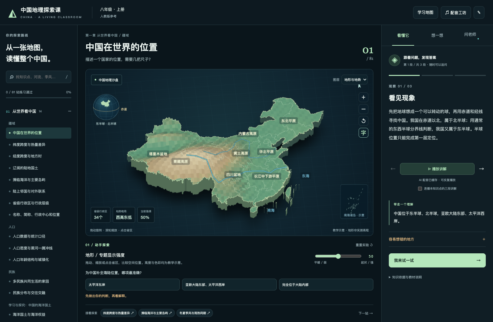

# 中国地理探索课 · 八年级上册

在线课堂：[中国地理探索课](https://china-geography-8a-chrisopal.chrisxie.chatgpt.site)（Sites 私密访问，需要所有者登录）。

本机启动后访问：**http://127.0.0.1:8767/**



独立于原“新疆地理沙盘”的新项目。围绕人教版新版公开五章目录，提供81个知识点、243段原创讲解、162道带解析练习；地图、讲解、实验与相关知识跳转连在一起。

## 启动

macOS 双击 `启动地理探索课.command`。或在此目录运行：

```sh
python3 server.py --open
```

需要 Python 3.9+ 和现代浏览器，不需要安装 npm 或 pip 依赖。默认只监听 `127.0.0.1`。端口占用时，双击启动会自动寻找附近空闲端口。关闭启动窗口或按 Ctrl+C 停止服务。不要直接双击 index.html；课程读取和问答需要本机服务。

## 建议的第一条学习路线

1. 从“中国在世界的位置”开始，旋转地图、点击省区。
2. 阅读三段讲解，或点击“播放讲解”。开启“连播”可连续听当前知识点。
3. 在沙盘下方操作模型、做动手题，再到右侧“想一想”回答迁移题。
4. 点击“接着探索”，把位置、地形、气候、河流、资源、生产生活和生态联系起来。
5. 不理解时打开“问老师”。老师会带着当前知识点与检索到的相关课程回答；参考节点可点击回看。

“学习地图”展示五章全部节点。浏览与练习通过分开记录，两道题都答对才标记“练习通过”，不代表孩子已经通过正式考试。学习进度和探索手记保存在当前浏览器，可导出备份。AI 问答只保留在当前页面内存，不会写入服务端日志。

## 能做的互动

- 全国模拟三维地图：拖动、缩放，9种专题层，34个省级行政区点击与定位挑战。
- 七类场景：全国地理、季风、河流泥沙、土地利用、能源组合、运输方式、流域修复。
- 五类计算实验：地方时、2020年人口密度、正午太阳高度、矩形河道流量、定流量条件下的束水原理。
- 每个节点配独立的情境选择、解析、迁移题、易错点和相关知识。只有明确匹配模型参数的选项才改变模型；纯概念判断不伪装成物理实验。
- 支持键盘：地图方向键旋转，`+/-` 缩放，Home 复位，`[` / `]` 选择省区、Enter 查看；`/` 搜索，R 复位。

## 问答服务

服务端调用 [OpenRouter Chat Completions](https://openrouter.ai/docs/api/api-reference/chat/send-chat-completion-request)，默认模型为 `google/gemini-3.1-flash-lite`。使用本地课程检索上下文、当前知识点和最近三轮对话。模型可能出错；界面保留参考节点用于核查，未将AI回答用于自动判题。

密钥从环境变量 `OPENROUTER_API_KEY` 或本机 `~/.config/china-geography-8a/openrouter.key` 读取。私密文件必须位于项目外，并设置为仅本人可读。仓库不含密钥，克隆后需要配置自己的密钥。Sites 版本在托管环境的 secret 中配置同名变量。

本机版可用 `OPENROUTER_MODEL` 环境变量更换问答模型。网络或额度异常时会明确提示；本地课程和练习不受影响。本机版仅监听回环地址；在线版由 Sites 私密访问策略保护。进度仍保存在当前浏览器，尚无多人账号或跨设备同步。

## 中文配音

[OpenRouter TTS](https://openrouter.ai/docs/guides/overview/multimodal/tts) 已接入，默认使用 `qwen/qwen-audio-3.0-tts-plus`、`longanlingxin` 声音。第一次点击发送当前固定讲稿生成 MP3。本机版保存到项目目录；Sites 版本使用临时边缘缓存，缓存失效后再次播放可能重新合成。首次生成需要网络并使用账户额度。第一知识点的三段已经生成；其余段落按需生成。

缓存文件名由讲稿内容、模型和声音共同决定，修改讲稿后不会误用旧音频。本机版可用 `OPENROUTER_TTS_MODEL` 和 `OPENROUTER_TTS_VOICE` 替换为已支持的模型/声音，再重启本机服务。声音风格仍可按孩子试听反馈调整；不使用浏览器系统朗读代替正式 TTS。

也可以使用自己的 TTS：

1. 点击“配音工坊”，导出 CSV 讲稿或 JSON 清单。
2. 生成 MP3/WAV/OGG/M4A/WebM，文件名按 cue 编号，如 `location-01.mp3`。
3. 批量导入。文件在此浏览器的 IndexedDB 保存，优先于同段 AI 配音。单文件上限50MB。导入音频不上传。

项目的 `narration/` 另附完整讲稿清单。音频以段落为单位同步到讲解步骤；不是逐字字幕或自动口型同步。连续播放只推进当前知识点，切换课程会停止旧音频。

## 教材和地图边界

课程以[教育部2022年地理课程标准](https://www.moe.gov.cn/srcsite/A26/s8001/202204/W020220420582354066450.pdf)为范围依据，以公开新版五章目录作编排参考。出版社旧版目录只有四章，公开新版扫描预览之间还存在页码及探究活动差异。**孩子具体教材版本尚未确认，不能把本项目称为已逐页核对其教材的官方完整课程。** 目录差异、覆盖矩阵和34组来源列于 `research/curriculum-audit.md`、`research/curriculum-map.json`、`curriculum.json`。

地理边界来自 DataV/高德学习交流数据，源页标注版本2021.5；高程、专题色彩、河道折线与实验数值是教学示意。它们不能用于测量真实海拔、人口、雨量，或预测自然灾害。省区定位含34个省级行政区，地图来源与简化方法见 `research/map-sources.md`。

## 文件与验证

核心文件：`index.html`、`styles.css`、`app.js`；`renderer.js` 与 `geo.js`；`labs.js`；`curriculum.json`；`server.py` 与 `speech.py`。采用原生浏览器能力和 Python 标准库，省去框架构建、数据库与额外依赖。

```sh
python3 tests/check_curriculum.py
python3 tests/check_server.py  # 先启动8767端口服务；不会发起付费模型请求
node tests/check_math.cjs
```

浏览器回归脚本在 `tests/browser-*.js`，使用现有 Playwright CLI 的 `run-code --filename=...` 执行，无需新测试依赖。结果、截图和实际模型响应在 `evidence/`；功能验证、配音可解码/播放、视觉检查与孩子真实学习效果是不同的证据。

## Sites 部署

`worker/api.mjs` 实现与本机 Python 服务一致的问答和配音接口；`scripts/build-sites.mjs` 将前端、课程数据、首课音频与接口打包成一个 Worker ESM，无需安装依赖。需要 Node.js 20+。

```sh
node tests/check_worker_api.mjs
node scripts/build-sites.mjs
node scripts/validate-sites.mjs
```

`.openai/hosting.json` 记录当前 Site ID。自行部署到新 Site 时，使用 Sites 工具创建自己的 Site 并替换该 ID，在运行时配置 `OPENROUTER_API_KEY` secret，再通过 Sites 的源码同步、保存版本、发布流程部署；不要将密钥写入源文件或 manifest。

目前线上访问范围为所有者，公开 GitHub 仓库与网站访问权限分别管理。不要在没有新增身份校验和持久化全局额度控制的情况下开放付费 AI 接口给匿名访问者。Worker 内的限流和音频去重以实例为单位，不是全局计费限额。

代码使用原生 JavaScript、Canvas、Python 标准库及 Cloudflare Worker Web APIs；地理数据和课程参考的来源及使用范围见 `research/`。仓库公开不代表第三方地图数据获得了额外商业授权。

在线 Worker 的模型和声音使用 `worker/api.mjs` 中的固定默认配置；变更后需重新构建并发布。
